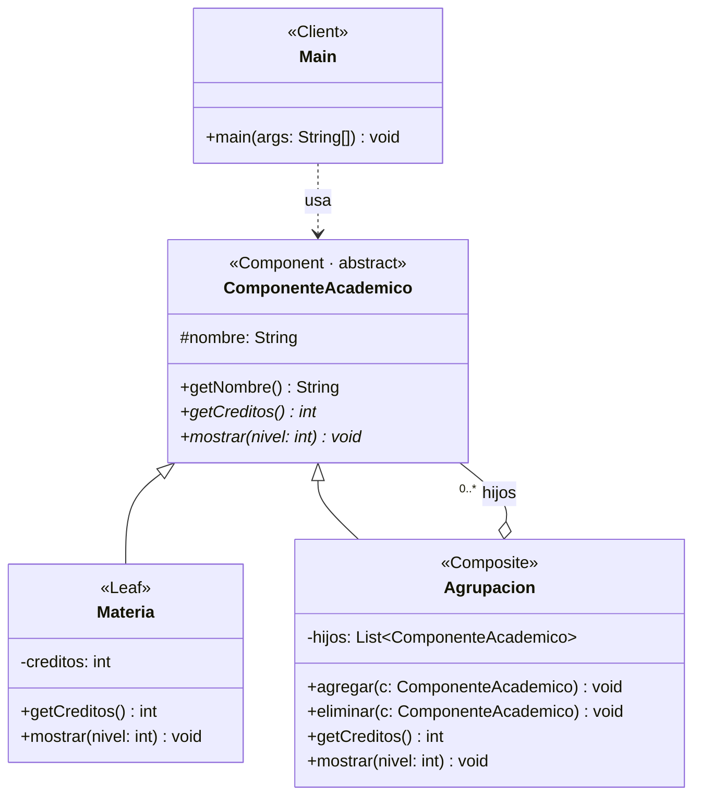
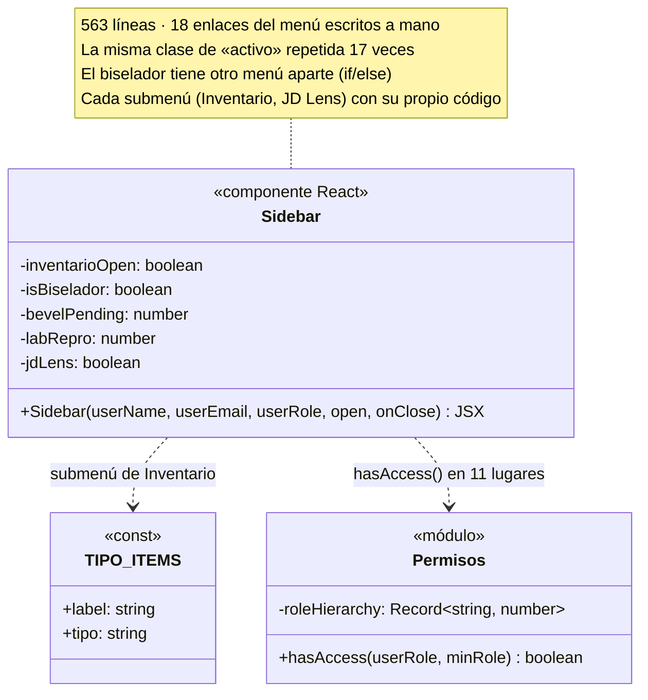
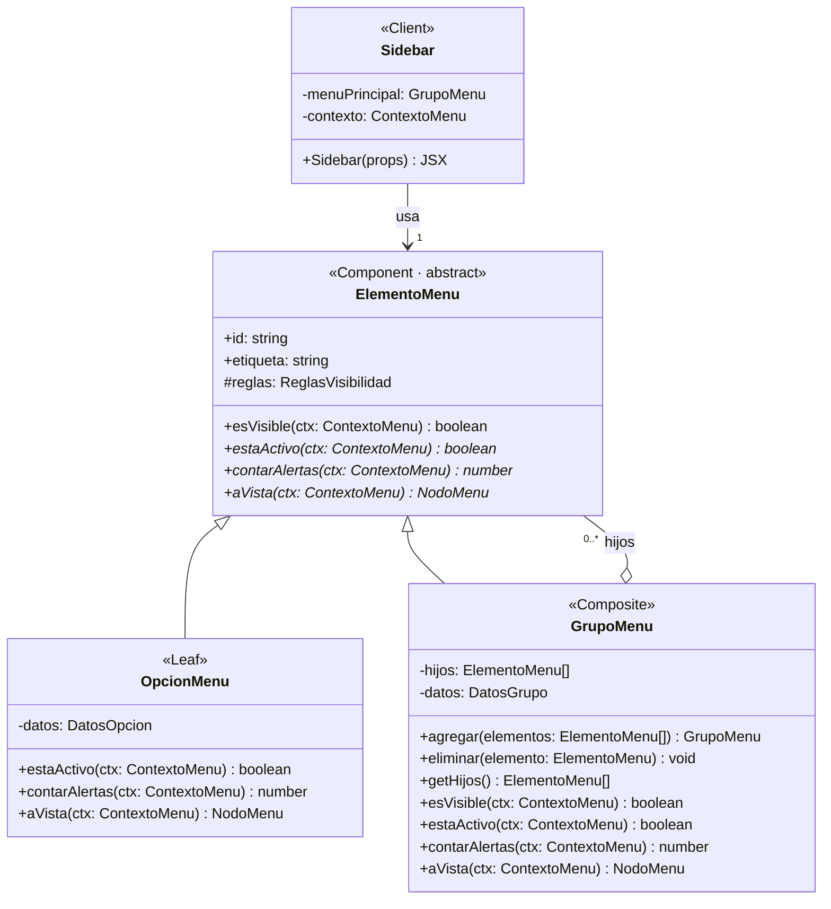
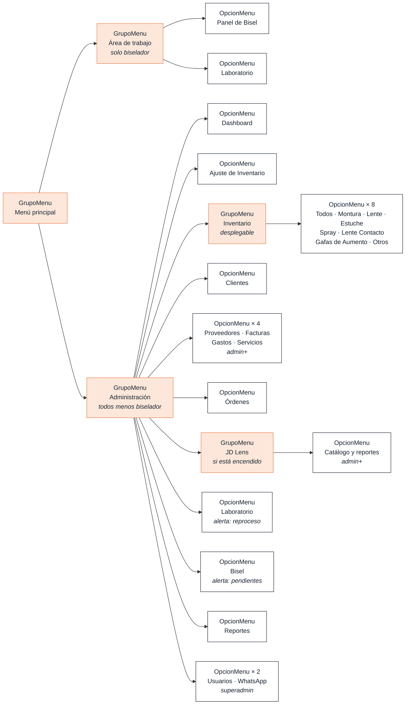

# Patrón Composite

> Patrón estructural (GoF). Permite componer objetos en estructuras de árbol y tratar igual a un elemento simple y a un grupo de elementos.

## Índice

- [Estructura del repositorio](#estructura-del-repositorio)
- [Problemática que resuelve](#problemática-que-resuelve)
- [Lo que se obtiene al aplicar el patrón](#lo-que-se-obtiene-al-aplicar-el-patrón)
- [Estructura del patrón en el ejemplo](#estructura-del-patrón-en-el-ejemplo)
- [Ventajas y desventajas en el ejemplo](#ventajas-y-desventajas-en-el-ejemplo)
- [Stack tecnológico del ejemplo](#stack-tecnológico-del-ejemplo)
- [Cómo ejecutar el repositorio](#cómo-ejecutar-el-repositorio)
- [Aplicación en OpticaSync Pro](#aplicación-en-opticasync-pro)

## Estructura del repositorio

```
patron-composite/
├── README.md
└── src/
    └── despues/                  ← código con el patrón aplicado
        ├── ComponenteAcademico.java   (Component)
        ├── Materia.java               (Leaf)
        ├── Agrupacion.java            (Composite)
        └── Main.java                  (Client)
```

## Problemática que resuelve

En muchos sistemas los datos tienen forma de **árbol**: hay elementos simples y grupos que contienen otros elementos, e incluso otros grupos. Un plan de estudios es un buen ejemplo: está formado por semestres, cada semestre tiene materias y dentro de un semestre puede haber un grupo de electivas con más materias.

Sin un patrón, el código que trabaja con esta estructura tiene que preguntar constantemente **"¿esto es una materia o una agrupación?"**:

```java
class Materia { String nombre; int creditos; }
class Agrupacion { String nombre; List<Object> elementos = new ArrayList<>(); }

static int calcularCreditos(Agrupacion a) {
    int total = 0;
    for (Object o : a.elementos) {
        if (o instanceof Materia m) {
            total += m.creditos;
        } else if (o instanceof Agrupacion sub) {
            total += calcularCreditos(sub);
        }
    }
    return total;
}
```

Esto genera varios problemas:

- **No hay un tipo común.** `Materia` y `Agrupacion` no comparten nada, así que la lista tiene que ser de `Object`. En ella cabe cualquier cosa, incluso datos que no deberían estar ahí.
- **El cliente depende de todas las clases concretas.** Tiene que conocer cada tipo y preguntar con `instanceof` antes de usarlo.
- **La lógica se repite.** Cada operación nueva (mostrar el plan, contar materias, etc.) necesita otro método con los mismos `if`.
- **El código queda cerrado al cambio.** Si aparece un tipo nuevo, por ejemplo `Laboratorio`, hay que modificar todos los métodos que recorren la estructura. Esto viola el principio Abierto/Cerrado.

**Composite** resuelve esto haciendo que los elementos simples y los grupos compartan la misma interfaz, para que el cliente los trate exactamente igual.

## Lo que se obtiene al aplicar el patrón

Con Composite, `Materia` y `Agrupacion` heredan de una clase abstracta común, `ComponenteAcademico`, y la agrupación guarda una lista de ese tipo común:

```java
abstract class ComponenteAcademico {
    protected String nombre;

    public ComponenteAcademico(String nombre) {
        this.nombre = nombre;
    }

    public abstract int getCreditos();
    public abstract void mostrar(int nivel);
}

class Materia extends ComponenteAcademico {
    private int creditos;

    public Materia(String nombre, int creditos) {
        super(nombre);
        this.creditos = creditos;
    }

    @Override
    public int getCreditos() {
        return creditos;
    }

    @Override
    public void mostrar(int nivel) {
        System.out.println("  ".repeat(nivel) + "- " + nombre + " (" + creditos + " cr)");
    }
}

class Agrupacion extends ComponenteAcademico {
    private List<ComponenteAcademico> hijos = new ArrayList<>();

    public Agrupacion(String nombre) {
        super(nombre);
    }

    public void agregar(ComponenteAcademico c) {
        hijos.add(c);
    }

    public void eliminar(ComponenteAcademico c) {
        hijos.remove(c);
    }

    @Override
    public int getCreditos() {
        int total = 0;
        for (ComponenteAcademico c : hijos) {
            total += c.getCreditos();
        }
        return total;
    }

    @Override
    public void mostrar(int nivel) {
        System.out.println("  ".repeat(nivel) + "+ " + nombre + " (" + getCreditos() + " cr)");
        for (ComponenteAcademico c : hijos) {
            c.mostrar(nivel + 1);
        }
    }
}
```

El cliente arma el árbol y luego lo usa con **una sola llamada**:

```java
plan.mostrar(0);
int total = plan.getCreditos();
```

Salida:

```
+ Plan Ingeniería de Sistemas (20 cr)
  + Semestre 1 (9 cr)
    - Cálculo Diferencial (4 cr)
    - Programación I (3 cr)
    - Introducción a la Ingeniería (2 cr)
  + Semestre 2 (11 cr)
    - Cálculo Integral (4 cr)
    - Programación II (3 cr)
    + Electivas (4 cr)
      - Ética (2 cr)
      - Inglés I (2 cr)
```

### Beneficios obtenidos

| Antes | Después |
|---|---|
| `List<Object>`: cualquier cosa cabe en la lista | `List<ComponenteAcademico>`: solo elementos del árbol |
| `if` / `instanceof` para saber el tipo | Polimorfismo: cada clase sabe responder |
| Un recorrido manual por cada operación | La agrupación delega en sus hijos (recursión) |
| Agregar un tipo obliga a modificar código existente | Se agrega una clase nueva sin tocar lo demás (Abierto/Cerrado) |

- **Tratamiento uniforme:** el cliente no distingue entre una materia y una agrupación; a ambas les pide lo mismo.
- **Anidamiento sin límite:** como la lista es del tipo común, una agrupación puede contener otras agrupaciones (por ejemplo, *Electivas* dentro de *Semestre 2*) a cualquier profundidad.
- **Cliente simple:** recorrer y calcular todo el árbol se reduce a `plan.getCreditos()` o `plan.mostrar(0)`.
- **Extensible:** un nuevo tipo de componente solo necesita heredar de `ComponenteAcademico` e implementar sus métodos.

## Estructura del patrón en el ejemplo

| Rol | Qué hace | En el ejemplo |
|---|---|---|
| **Component** | Clase abstracta común. Declara lo que se le puede pedir a cualquier elemento del árbol. | `ComponenteAcademico` |
| **Leaf** (hoja) | Elemento simple, sin hijos. Tiene el dato real y responde directamente. | `Materia` |
| **Composite** | Grupo que guarda una lista de `Component` (hojas u otros grupos) y responde preguntándole a sus hijos. | `Agrupacion` |
| **Client** | Usa todo a través de `Component`, sin saber si es hoja o grupo. | `Main` |



**Cómo leer el diagrama:** `+` público, `-` privado, `#` protegido; los métodos en *cursiva* son abstractos; el triángulo hueco es herencia y el rombo hueco es agregación, con multiplicidad `0..*`.

> En el ejemplo, `agregar()` y `eliminar()` están solo en `Agrupacion`, no en `ComponenteAcademico`. Es la variante "segura" del patrón: una `Materia` no tiene métodos que no puede usar, a cambio de que el cliente deba saber cuál objeto es un grupo al armar el árbol.

## Ventajas y desventajas en el ejemplo

Ventajas y desventajas **del código de este repositorio** (el plan de estudios), comprobadas ejecutándolo.

### Ventajas

| Ventaja | En el ejemplo |
|---|---|
| **Una sola llamada** | `plan.getCreditos()` suma todo el plan (20 créditos) sin recorrerlo a mano. |
| **Grupos dentro de grupos** | *Electivas* está dentro de *Semestre 2* sin código extra: `Agrupacion` guarda `ComponenteAcademico`, no solo `Materia`. |
| **Tipo nuevo sin tocar nada** | Un `Laboratorio` que herede de `ComponenteAcademico` funciona dentro de cualquier semestre sin cambiar `Agrupacion` ni `Main` (principio Abierto/Cerrado). |
| **Lista segura** | `List<ComponenteAcademico>`: en el árbol ya no cabe cualquier `Object`; el compilador lo impide. |

### Desventajas

| Desventaja | En el ejemplo |
|---|---|
| **No es del todo uniforme** | `agregar()` solo existe en `Agrupacion`. Para armar el árbol, `Main` declara las variables como `Agrupacion` y no como `ComponenteAcademico`. |
| **Sin control de ciclos** | `semestre.agregar(semestre)` compila, pero al llamar `getCreditos()` la recursión no termina y lanza `StackOverflowError`. |
| **Se recalcula todo** | `mostrar()` llama a `getCreditos()` en cada `Agrupacion`, así que el mismo subárbol se recorre varias veces. En un plan pequeño no se nota; en uno muy grande sí. |
| **Sin reglas del dominio** | Nada impide meter el *Plan* dentro de un *Semestre* o repetir una materia: el patrón da la forma del árbol, no las reglas del negocio. |

## Stack tecnológico del ejemplo

| Elemento | Detalle |
|---|---|
| Lenguaje | **Java 11 o superior** (se usa `String.repeat`, disponible desde Java 11) |
| Paradigma | Programación orientada a objetos: herencia, clase abstracta y polimorfismo |
| Librerías | Ninguna externa; solo `java.util.List` y `java.util.ArrayList` |
| Editor | IntelliJ IDEA, NetBeans o VS Code con *Extension Pack for Java* |
| Control de versiones | Git y GitHub |
| Diagramas | UML de clases con Mermaid |

## Cómo ejecutar el repositorio

Requisito: JDK instalado (`java -version` debe mostrar 11 o superior).

```bash
git clone https://github.com/Luis301311/patron-composite.git
cd patron-composite
javac -encoding UTF-8 -d out src/despues/*.java
java -cp out despues.Main
```

Salida esperada:

```
+ Plan Ingeniería de Sistemas (20 cr)
  + Semestre 1 (9 cr)
    - Cálculo Diferencial (4 cr)
    - Programación I (3 cr)
    - Introducción a la Ingeniería (2 cr)
  + Semestre 2 (11 cr)
    - Cálculo Integral (4 cr)
    - Programación II (3 cr)
    + Electivas (4 cr)
      - Ética (2 cr)
      - Inglés I (2 cr)

Total de créditos: 20
```

> En Windows, si las tildes salen como `?`, ejecutar primero `chcp 65001` o usar `java -Dfile.encoding=UTF-8 -cp out despues.Main`.

---

## Aplicación en OpticaSync Pro

OpticaSync Pro es el sistema de gestión de la óptica JD Fashion Distribuidora Óptica (Next.js + TypeScript, FastAPI + PostgreSQL, Flutter). El patrón se aplicó sobre el código real, en el menú lateral de la web (`apps/web/components/sidebar.tsx` y `apps/web/lib/menu/`), rama `feature/patron-composite`. El repositorio del proyecto es privado; aquí se muestran los fragmentos principales.

### 1. Problema en OpticaSync

El menú lateral de la web (`apps/web/components/sidebar.tsx`) tiene forma de **árbol**:

```
Administración                       ← sección
├── Dashboard                        ← opción
├── Ajuste de Inventario
├── Inventario                       ← submenú desplegable
│   ├── Todos · Montura · Lente · Estuche
│   └── Spray · Lente Contacto · Gafas de Aumento · Otros
├── Clientes · Proveedores · Facturas · Gastos · Servicios · Órdenes
├── JD Lens Experience               ← enlace con submenú
│   └── Catálogo y reportes
├── Laboratorio (contador de reprocesos) · Bisel (contador de pendientes)
└── Reportes · Usuarios · WhatsApp
Área de trabajo                      ← sección que solo ve el biselador
├── Panel de Bisel
└── Laboratorio
```

Pero el código no lo trataba como un árbol. Cada opción estaba escrita a mano en JSX, una debajo de la otra:

- **563 líneas** y **18 enlaces** copiados con el mismo `<Link>`, las mismas clases y su propia regla de resaltado. La clase de «opción activa» aparecía **17 veces**.
- El permiso por rol (`hasAccess(userRole, 'admin')`) se repetía en **11 lugares**.
- El biselador tenía **otro menú completo** dentro de un `if/else`.
- Cada submenú tenía su propio código: Inventario con un `useState` y un `map` sobre `TIPO_ITEMS`; JD Lens con otra lista anidada escrita aparte.
- Agregar una opción nueva implicaba copiar y pegar ~20 líneas de JSX. Agregar un submenú nuevo, escribir otra vez la lógica de abrir y cerrar.

### 2. Código ANTES

`apps/web/components/sidebar.tsx` (snapshot en el repositorio de OpticaSync Pro)

```tsx
const roleHierarchy: Record<string, number> = { user: 0, admin: 1, superadmin: 2 }

function hasAccess(userRole: string, minRole?: string): boolean { /* ... */ }

export function Sidebar({ userRole, ... }) {
  const [inventarioOpen, setInventarioOpen] = useState(pathname.startsWith('/inventario'))
  const isBiselador = userRole === 'biselador'
  // ...
  <nav>
    {isBiselador ? (
      <> {/* menú del biselador: Panel de Bisel y Laboratorio, escritos a mano */} </>
    ) : (
      <ul>
        <li>
          <Link href="/" className={cn('flex items-center gap-3 ...',
              pathname === '/' ? 'bg-sidebar-primary ...' : 'text-sidebar-foreground/70 ...')}>
            <LayoutDashboard className="h-[18px] w-[18px]" />
            Dashboard
          </Link>
        </li>
        {/* ... el mismo bloque para Ajustes, Clientes ... */}
        {hasAccess(userRole, 'admin') && (
          <li>
            <Link href="/proveedores" className={cn(/* las mismas clases otra vez */)}>
              <Users className="h-[18px] w-[18px]" />
              Proveedores
            </Link>
          </li>
        )}
        {/* ... y así 15 opciones más, cada una con su hasAccess y su regla de activo */}
      </ul>
    )}
  </nav>
}
```

### 3. Diagrama de clases ANTES



### 4. Solución aplicada

**Composite**: las opciones sueltas y los grupos (secciones y submenús) comparten la misma clase abstracta, `ElementoMenu`. El menú completo es un solo árbol y la vista lo recorre sin preguntar si un elemento es opción o grupo.

| Rol en Composite | Clase | Responsabilidad |
|---|---|---|
| **Component** | `ElementoMenu` (abstracta) | Lo que se le puede pedir a cualquier elemento: `esVisible`, `estaActivo`, `contarAlertas`, `aVista` |
| **Leaf** | `OpcionMenu` | Una opción con enlace: Dashboard, Clientes, Bisel... Responde con sus propios datos |
| **Composite** | `GrupoMenu` | Una sección o un submenú. Guarda una lista de `ElementoMenu` y responde preguntándole a sus hijos |
| **Client** | `Sidebar` | Arma el contexto (rol, ruta, contadores) y pinta el árbol con un componente recursivo |

Lo que hace cada operación en el grupo:

- `esVisible`: se muestra si cumple su regla **y** tiene al menos un hijo visible (o un enlace propio).
- `estaActivo`: usa su regla propia (Inventario: toda ruta `/inventario`) o, si no tiene, se resalta si **algún hijo** está activo.
- `contarAlertas`: **suma** los contadores de sus hijos visibles, a cualquier profundidad.
- `aVista`: devuelve el nodo con sus hijos ya resueltos (recursión), sin los que no se ven.

¿Por qué este patrón y no otro?

- Los datos **ya eran un árbol** (secciones → opciones → subopciones) y había que tratar igual a una opción y a un grupo: es exactamente el problema de Composite.
- **No Decorator**: no se trata de agregarle comportamiento a una opción, sino de agrupar opciones.
- **No una lista plana con `if`**: los permisos y las reglas de resaltado seguirían repartidos en el JSX, y un nivel más de submenú obligaría a escribir otro bloque.

El permiso por rol se volvió **regla de visibilidad**: el biselador ya no tiene un menú aparte, es una sección más del mismo árbol (`condicion: rol === 'biselador'`).

### 5. Código DESPUÉS

`apps/web/lib/menu/elemento-menu.ts` — Component:

```ts
export abstract class ElementoMenu {
  constructor(
    readonly id: string,
    readonly etiqueta: string,
    protected readonly reglas: ReglasVisibilidad = {},
  ) {}

  esVisible(ctx: ContextoMenu): boolean {
    if (!tieneAcceso(ctx.rol, this.reglas.rolMinimo)) return false
    return this.reglas.condicion ? this.reglas.condicion(ctx) : true
  }

  abstract estaActivo(ctx: ContextoMenu): boolean
  abstract contarAlertas(ctx: ContextoMenu): number
  abstract aVista(ctx: ContextoMenu): NodoMenu | null
}
```

`apps/web/lib/menu/opcion-menu.ts` — Leaf:

```ts
export class OpcionMenu extends ElementoMenu {
  estaActivo(ctx: ContextoMenu): boolean {
    return this.datos.coincide ? this.datos.coincide(ctx) : ctx.ruta.startsWith(this.datos.href)
  }

  contarAlertas(ctx: ContextoMenu): number {
    return this.datos.alertas ? this.datos.alertas(ctx) : 0
  }
  // aVista(): devuelve su nodo, sin hijos
}
```

`apps/web/lib/menu/grupo-menu.ts` — Composite:

```ts
export class GrupoMenu extends ElementoMenu {
  private readonly hijos: ElementoMenu[] = []

  agregar(...elementos: ElementoMenu[]): this {
    this.hijos.push(...elementos)
    return this
  }

  estaActivo(ctx: ContextoMenu): boolean {
    if (this.datos.coincide) return this.datos.coincide(ctx)
    return this.hijos.some((h) => h.esVisible(ctx) && h.estaActivo(ctx))
  }

  contarAlertas(ctx: ContextoMenu): number {
    return this.hijos
      .filter((h) => h.esVisible(ctx))
      .reduce((total, h) => total + h.contarAlertas(ctx), 0)   // si es otro grupo, hace lo mismo
  }

  aVista(ctx: ContextoMenu): NodoMenu | null {
    if (!this.esVisible(ctx)) return null
    const hijos = this.hijos.map((h) => h.aVista(ctx)).filter((n) => n !== null)
    return { /* ... */ hijos }
  }
}
```

`apps/web/lib/menu/menu-principal.ts` — el árbol real, declarado una sola vez:

```ts
const administracion = new GrupoMenu('administracion', 'Administración', {
  condicion: (ctx) => ctx.rol !== 'biselador',
}).agregar(
  new OpcionMenu('dashboard', 'Dashboard', { href: '/', icono: LayoutDashboard, coincide: (ctx) => ctx.ruta === '/' }),
  inventario(),                                       // GrupoMenu desplegable con 8 OpcionMenu
  new OpcionMenu('proveedores', 'Proveedores', { href: '/proveedores', icono: Users, rolMinimo: 'admin' }),
  new OpcionMenu('bisel', 'Bisel', {
    href: '/bisel', icono: Gem, rolMinimo: 'admin',
    alertas: (ctx) => ctx.alertas.bisel, tonoAlerta: 'destructivo',
  }),
  // ...
)
```

`apps/web/components/sidebar.tsx` — Client:

```tsx
const menuPrincipal = construirMenuPrincipal()

export function Sidebar({ userRole, ... }) {
  const contexto: ContextoMenu = {
    rol: userRole, ruta: pathname, tipo: searchParams.get('tipo'), jdLens,
    alertas: { bisel: bevelPending, reproceso: labRepro },
  }
  const secciones = menuPrincipal.aVista(contexto)?.hijos ?? []
  // ...
  {secciones.map((seccion) => /* título + seccion.hijos.map(nodo => <ElementoMenuVista nodo={nodo} />) */)}
}

/** Pinta cualquier elemento, opción o grupo, y se llama a sí misma para los hijos. */
function ElementoMenuVista({ nodo, nivel = 1, ... }) { /* ... */ }
```

| Archivo | Responsabilidad |
|---|---|
| `lib/menu/tipos.ts` | `ContextoMenu`, `NodoMenu`, reglas de visibilidad |
| `lib/menu/roles.ts` | `tieneAcceso(rol, rolMinimo)` (antes `hasAccess`) |
| `lib/menu/elemento-menu.ts` | Component `ElementoMenu` |
| `lib/menu/opcion-menu.ts` | Leaf `OpcionMenu` |
| `lib/menu/grupo-menu.ts` | Composite `GrupoMenu` |
| `lib/menu/menu-principal.ts` | `construirMenuPrincipal()`: el árbol de OpticaSync |
| `lib/menu/index.ts` | Exportaciones |
| `components/sidebar.tsx` | Client: contexto + componente recursivo `ElementoMenuVista` |

### 6. Diagrama de clases DESPUÉS



Árbol de objetos que arma `construirMenuPrincipal()` (los grupos en naranja):



### 7. Resultado

| | Antes | Después |
|---|---|---|
| `sidebar.tsx` | 563 líneas | 286 líneas (+ 363 en `lib/menu`, con la lógica separada de la vista) |
| Opciones del menú | 18 bloques JSX copiados | 1 línea `new OpcionMenu(...)` cada una |
| Permisos por rol | `hasAccess` en 11 lugares del JSX | `rolMinimo` / `condicion` en cada elemento |
| Menú del biselador | Otro menú en un `if/else` | Una sección más del mismo árbol |
| Submenús | Código propio para cada uno | Un `GrupoMenu`; la vista es recursiva |
| Nueva opción o submenú | Copiar ~20 líneas de JSX | Agregar un elemento al árbol |
| Pruebas | Ninguna | 13 pruebas en `lib/menu/__tests__/menu.test.ts` |

**El comportamiento no cambia.** Se verificó renderizando el menú viejo y el nuevo para los cuatro roles (user, admin, superadmin, biselador) en seis rutas distintas: el HTML resultante es **idéntico** en los 24 casos.

### 8. Pruebas

```bash
pnpm --filter web test
```

`lib/menu/__tests__/menu.test.ts` cubre:

- Composite puro: un grupo suma las alertas de grupos anidados, se resalta si un hijo a cualquier nivel lo está, y se oculta si no tiene hijos visibles.
- El menú real: las opciones exactas que ve cada rol, JD Lens solo encendido, el resaltado de Inventario según `?tipo=` y los contadores de bisel y reproceso.
